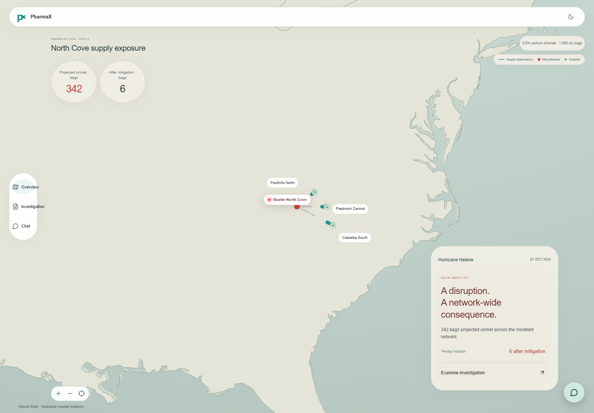
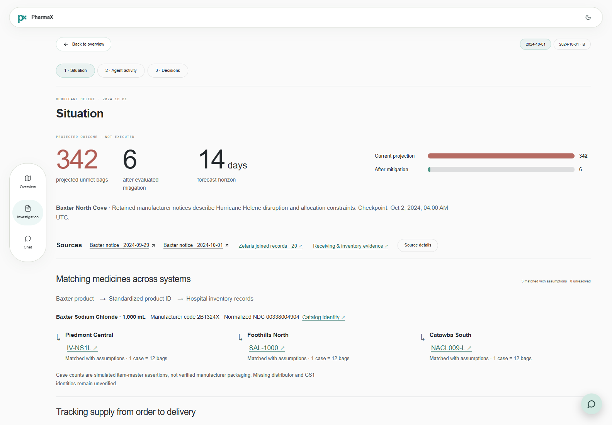
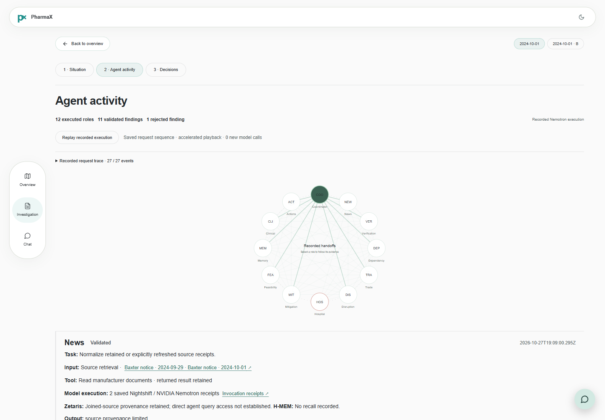
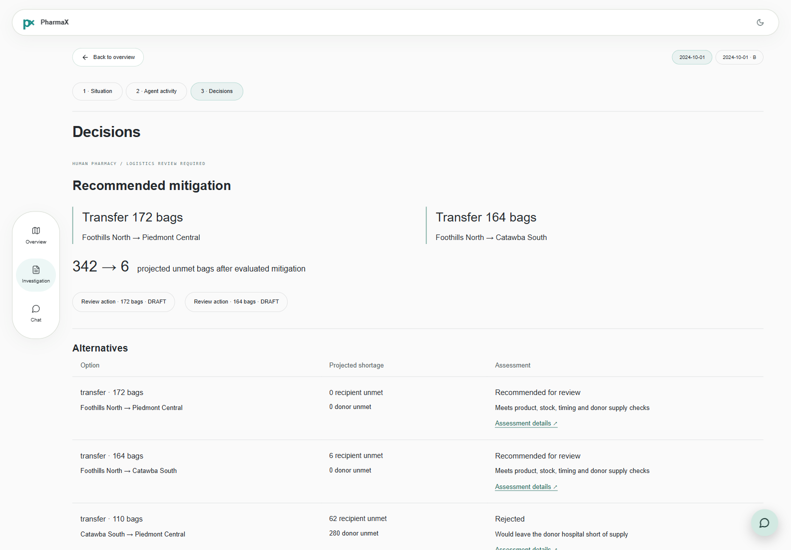
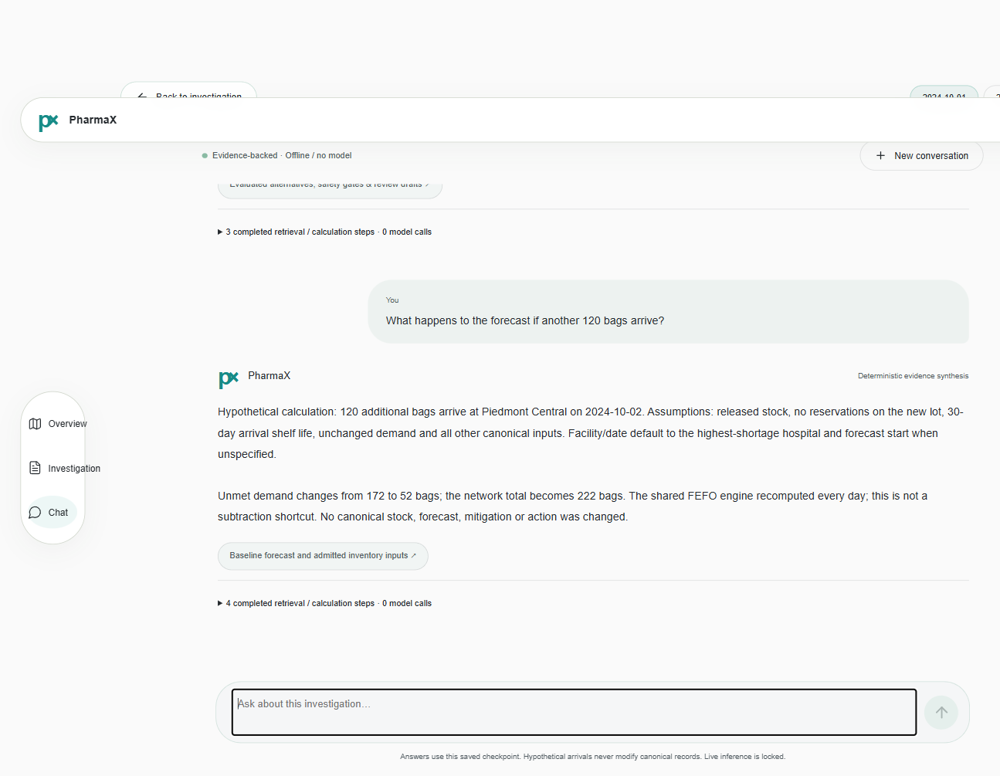
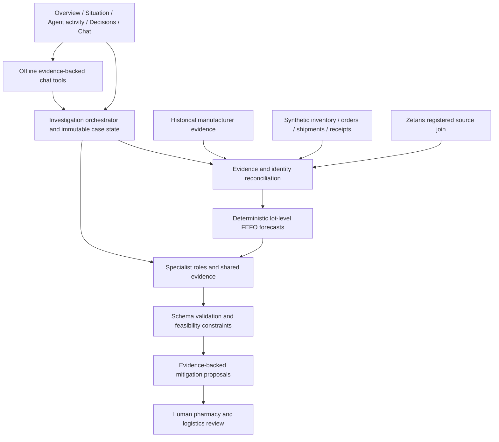
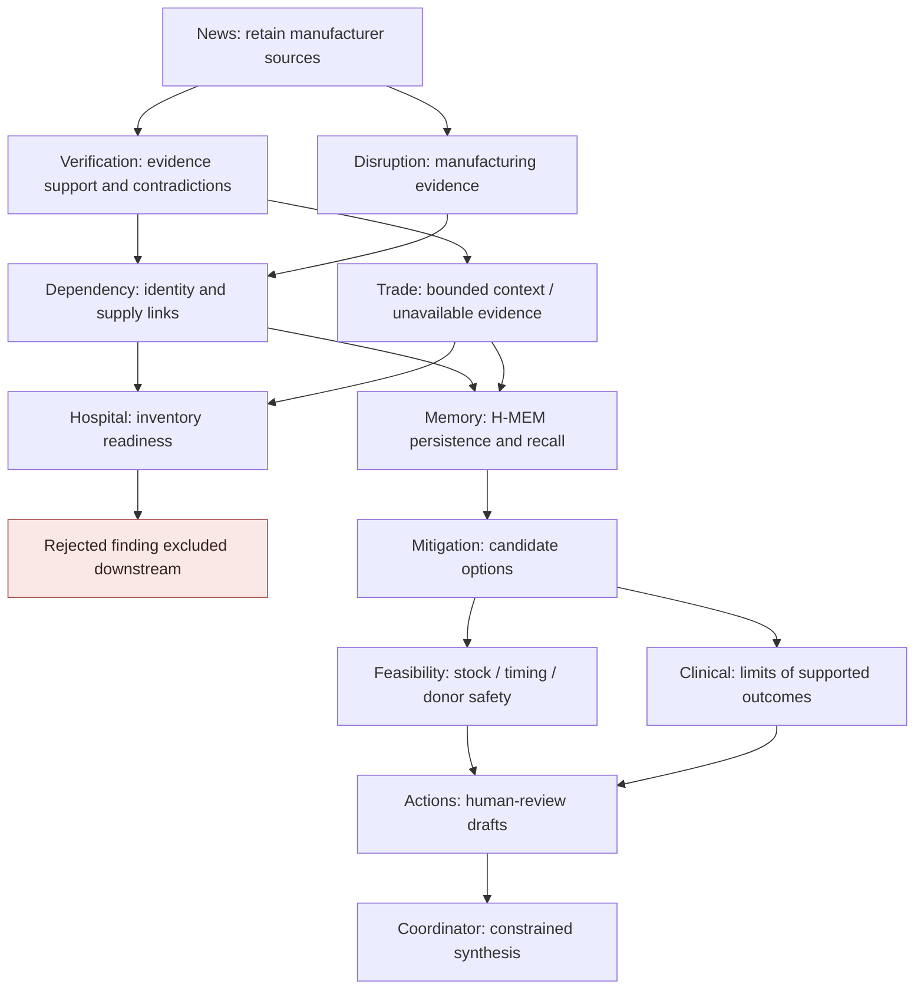
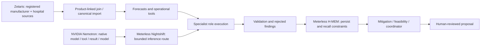

# PharmaX

**Spot medicine shortages early. Get essential supplies where they're needed.**

PharmaX reconciles manufacturer evidence with hospital inventory records, forecasts shortages and evaluates redistribution proposals for human review. Operators can inspect each source, calculation, saved specialist finding and rejected alternative.

**Open Agent Hackathon 2026 · Reasoning Architecture**

## Quickstart

Requires **Python 3.12**, **uv** (verified 0.13.5), and **Node 24** (verified 24.22.1). No NVIDIA GPU, sponsor credentials or paid inference is required.

```sh
git clone https://github.com/sidhantjha/PharmaX.git
cd PharmaX
uv sync --locked --all-groups
node --version
uv run python scripts/prepare_demo.py --fetch-sources
uv run python scripts/pharmax_demo.py --serve --port 8898 --output-dir .runtime/demo
```

The explicit bootstrap downloads the four hash-pinned manufacturer documents needed by this demo, then runs the existing offline calculations. It stops if a publisher changes the expected bytes. Later sample execution and chat use local evidence; they do not silently refresh sources or call a model. Source originals are downloaded rather than redistributed in Git.

In a second terminal:

```sh
cd PharmaX/phases/phase_01_foundation/dashboard_design
npm ci
PHARMAX_API_TARGET=http://127.0.0.1:8898 npm run dev -- --port 5195 --strictPort
```

Open [the local application](http://127.0.0.1:5195). Select **Investigation → Situation → Agent activity → Decisions**, then **Chat**. This is a localhost development demo, not a publicly hosted service.

On Windows, use a native Python 3.12/Node 24 installation or WSL2 Ubuntu. Never share a virtual environment or `node_modules` between Windows and Linux. In PowerShell, replace the frontend command with:

```powershell
$env:PHARMAX_API_TARGET = 'http://127.0.0.1:8898'
npm run dev -- --port 5195 --strictPort
```

If `node` resolves to an older version, set `PHARMAX_NODE` to your existing Node 24 executable before preparing samples. `.node-version`, `.python-version`, `uv.lock` and `package-lock.json` record the runtime/dependency boundary.

## Problem and product

Manufacturer, distributor and hospital systems describe the same medicine with different identifiers and quantities. A requested purchase order, allocation percentage, supplier acknowledgment, ship notice and accepted receipt do not establish the same fact. Treating them as interchangeable can overstate usable supply.

PharmaX serves pharmacy and supply-chain operators who need to understand where shortages are projected, which evidence supports an arrival, and whether a transfer would endanger the donor hospital. Its outputs are conditional operational projections, not clinical advice or automatic shipment instructions.

| Geographic overview | Situation and product matching |
| --- | --- |
|  |  |

| Recorded agent activity | Mitigation decisions |
| --- | --- |
|  |  |



**Demo video:** pending maintainer URL.

<h2>Presentation</h2>

<a href="PharmaX_Hackathon_Submission_Deck_Final.pdf" target="_blank" rel="noopener noreferrer">View PharmaX Presentation (PDF)</a>

<a href="PharmaX_Hackathon_Submission_Deck_Final.pptx">Download PowerPoint (PPTX)</a>


## Measured Hurricane Helene case study

The retained Baxter North Cove investigation combines historical public manufacturer notices with a **synthetic three-hospital network**.

| Canonical 14-day projection | Recorded result |
| --- | ---: |
| Network unmet demand before mitigation | 342 bags |
| Network unmet demand after evaluated mitigation | 6 bags |
| Foothills North → Piedmont Central proposal | 172 bags |
| Foothills North → Catawba South proposal | 164 bags |

These transfers were **proposed and evaluated, not executed**. Human pharmacy/logistics authorization, inventory verification, donor release and transport checks remain required. Canonical replay includes supported modeled inbound assumptions; the conservative operational forecast excludes unconfirmed supply and can differ.

The item-master examples map `IV-NS1L`, `SAL-1000` and `NACL009-L` to the same catalog-anchored presentation and normalized NDC `00338004904`. The 12-bag case count is a synthetic item-master assertion, not verified manufacturer packaging. Ambiguous identities remain unresolved.

The separate reconciliation Case B records **800 bags reported shipped, 500 accepted and 300 unexplained**. The system does not infer loss, theft, delivery or disposition from that difference. The main October 1 checkpoint instead has 84- and 67-bag ship notices without accepted receiving records; it never substitutes Case B's quantities.

## System architecture



### Actual recorded collaboration

The diagram shows a readable subset of actual dependency edges; redundant transitive predecessors are omitted. All twelve recorded roles are represented. The timeline retains the complete predecessor relationships, timestamps and validation decisions.



Hospital combined fact keys into a malformed string and exhausted its three-turn allowance. Its finding remained rejected. Downstream accepted findings use retained evidence and valid predecessor findings; the failed Hospital output is not promoted to a validated result. No invented thoughts, debates, votes or retries appear in replay.

### Sponsor technology architecture



| Technology | Actual contribution | Saved proof |
| --- | --- | --- |
| Zetaris | Registered manufacturer/hospital feeds, product-linked join, downstream import and source mutation | [Join proof](docs/evidence/pharmax-sponsors/zetaris-final-verified/proof.json) |
| Meterless Nightshift | Primary inference transport and saved native invocation receipts | [Recorded execution summary](docs/evidence/pharmax-sponsors/full-agent-run/final/summary.json) |
| NVIDIA Nemotron | Specialist model → tool → result → model execution | [Coordinator receipts](docs/evidence/pharmax-sponsors/full-agent-run/final/coordinator.json) |
| Meterless H-MEM | Persisted findings and recalled rejected candidates constraining later decisions | [Memory export](docs/evidence/pharmax-sponsors/full-agent-run/final/hmem.json) |

Not every agent directly queried Zetaris. A retained upstream join trace is not evidence of direct role access. Chat currently invokes deterministic investigation tools, **not new Nemotron inference**.

## Real execution evidence

| Saved measurement | Verified count |
| --- | ---: |
| Specialists executed | 12 / 12 |
| Validated findings | 11 / 12 |
| Nemotron model requests | 27 |
| Zetaris product-linked returned rows | 20 |
| H-MEM writes / recalled records | 11 / 5 |

The recorded source-mutation acceptance changed central unmet demand from 172 to 72 after 100 additional synthetic inventory bags entered through Zetaris. Current sample preparation independently recomputes the same inventory sensitivity offline; that fresh calculation is not a new live Zetaris run.

See the [saved execution audit](docs/evidence/pharmax-sponsors/full-agent-run/final/audit.json), [trace](docs/evidence/pharmax-sponsors/full-agent-run/final/trace.json), [recorded case](docs/evidence/recorded-case.json), and [sanitized projection manifest](docs/evidence/projection-manifest.json). Machine paths were removed from JSON projections. Recorded original tool hashes refer to original bytes, not the sanitized serialization; the manifest records both digests.

The accepted source worktree recorded **523 backend tests** and **53 frontend tests** passing. Later Situation/Decisions/drawer changes passed seven relevant frontend tests, TypeScript and production build. These are historical receipts, not a claim that a full suite ran in this new release. The release's clean-clone verification is recorded in [RELEASE_CHECKS.md](docs/RELEASE_CHECKS.md).

## Three reproducible inputs

`scripts/prepare_demo.py` calls the existing `phases.phase_08_operations.judge_samples` workflow. Each input is a distinct editable CSV export, not a hardcoded answer.

| Input | Central inventory change | Calculated central unmet bags |
| --- | ---: | ---: |
| Baseline | 0 | 172 |
| Additional inventory | +100 synthetic bags | 72 |
| Additional inventory | +300 synthetic bags | 0 |

Inspect `.runtime/examples/*/inputs/2024-10-01/inventory.csv`, the generated `case.json` files and `.runtime/examples/summary.json`. To rerun in fresh directories:

```sh
uv run python -m phases.phase_08_operations.judge_samples \
  --output-dir .runtime/another-input-run --store-root .runtime/another-store
```

To import a supported edited feed, use the typed operational import API documented by its [contract](contracts/operations.py) and [operations implementation](phases/phase_08_operations/ingestion.py). Source clock, identity and hash failures stop the import. Do not edit retained source bytes in place or reuse a reserved inventory workspace with a different basis.

### Offline chat

Try “Which hospitals face the greatest saline shortage?”, “What mitigation options were evaluated?” or “What happens to the forecast if another 120 bags arrive?” in Chat. Responses cite case-scoped read-only source resources. Hypotheticals recompute the FEFO engine on a copy and do not mutate canonical records. New conversation resets the displayed chat scope.

```sh
curl -X POST http://127.0.0.1:8898/api/v1/helene/cases/helene-2024-10-01-f3aca5a9fbfd/chat \
  -H 'Content-Type: application/json' \
  -d '{"question":"Which hospitals face the greatest saline shortage?","mode":"offline"}'
```

The response explicitly reports `mode: offline-deterministic` and `model_executed: false`. Follow returned citation URLs; do not construct source claims from arbitrary IDs.

## Tests and troubleshooting

```sh
uv run pytest -q phases/phase_06_helene/tests/test_chat.py
uv run ruff check contracts phases scripts/verify.py
cd phases/phase_01_foundation/dashboard_design
npm run typecheck
npm run build
npm test -- src/heleneReplay.test.tsx src/productTraceability.test.tsx src/heleneChat.test.tsx
```

- **H-MEM cannot import TypeScript:** verify Node 24; set `PHARMAX_NODE` explicitly if your PATH selects Node 18.
- **Native npm binding missing:** install dependencies in the same OS that runs Node; do not share Windows/Linux `node_modules`.
- **Changed source hash:** bootstrap stops rather than substituting revised evidence. Record a reviewed new source revision instead of weakening the hash check.
- **Inventory workspace basis conflict:** use a separate fresh store for a different source basis. The guard prevents inventory reservations from being reset by reimport.
- **Port occupied:** choose another local backend port and update `PHARMAX_API_TARGET` to match.
- **Large globe build chunk:** known build warning; it is not an inference dependency or failed build.

Authenticated live Zetaris/Nightshift modes are optional, separately configured paths. `.env.example` contains placeholders only. The sample runner never loads credentials, authorizes inference or falls back to a direct NVIDIA provider.

## Safety and limitations

Historical manufacturer documents are distinct from simulated hospital operations. Historical document custody is reconstructed. Clinical outcomes, real ERP access, authenticated pharmacy authority and executed transfers are not established. Unsupported specialist findings remain rejected. Physical supply actions require human pharmacy and logistics review. See [data provenance and evidence boundaries](docs/PROVENANCE.md).

## Stack and project structure

- **Backend:** Python 3.12, Pydantic contracts, SQLite immutable case/event stores, deterministic FEFO calculations, local HTTP API.
- **Frontend:** React 19, TypeScript, Vite 8, Three.js/react-globe.gl, Base UI, Lucide.
- **Reasoning/data:** Nightshift/Nemotron recorded specialist execution, H-MEM reference engine, Zetaris source federation.

```text
contracts/                         Typed boundaries and exported schemas
phases/phase_01_foundation/         Foundation + dashboard_design React app
phases/phase_02_data/               Source normalization
phases/phase_03_risk/               Inventory/forecast engine
phases/phase_04_agents/             Specialists, H-MEM and intelligence service
phases/phase_05_product/            Operator service and saved native receipts
phases/phase_06_helene/             Helene replay and scoped offline chat
phases/phase_07_reconciliation/     Claims, receiving and evidence reconciliation
phases/phase_08_operations/         Product identity and reviewed fulfillment
scripts/prepare_demo.py            Explicit bootstrap and reproducible examples
docs/evidence/                     Sanitized genuine recorded evidence
docs/assets/                       Actual application screenshots and Mermaid sources
```

## Future work and acknowledgments

Priorities are authorized hospital/ERP connectivity, continuous reviewed source updates, independent pharmacy validation, and deployment/monitoring hardening. Conversational Nemotron inference is a future separately authorized integration.

Sidhant is the submitting maintainer; final team roles must be confirmed in HackOS. H-MEM, adapted UI primitives and dependencies retain their upstream notices. Cursor development is user-reported, without a claimed Cursor Agent/Space XAI execution transcript. [Pre-existing work and attribution](docs/PROVENANCE.md) explain the source lineage and excluded pre-October-22 CityPulse planning material. Fresh Git history does not erase that provenance.

[License](LICENSE) · [Third-party notices](THIRD_PARTY_NOTICES.md)
